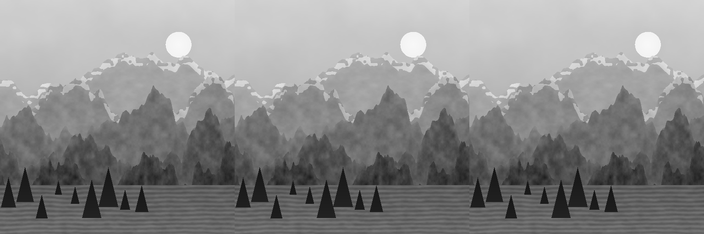

# ЛАБОРАТОРНА РОБОТА №3

Реалізація алгоритмів стиснення з втратами

Дискретне косинусне перетворення та дискретне вейвлет-перетворення Хаара

Левківський Євгеній Сергійович
ІПС-41

---

## 1. Мета роботи

Реалізувати прямі та обернені DCT і DWT без готових функцій перетворення; дослідити вплив кількості збережених коефіцієнтів на якість відновлення зображень; порівняти результати візуально та за PSNR.

## 2. Програмна реалізація

Розроблено браузерний застосунок на HTML, CSS та JavaScript. Перетворення написано у js/compression.js з використанням Float64Array. Модулі js/samples.js і js/app.js відповідають за відтворювані зразки та інтерфейс. Залежностей для роботи програми немає; готові dct(), idct(), dwt(), idwt() та бібліотеки перетворень не використовуються. При запуску через HTTP обчислення виконуються у Web Worker. Локальний index.html працює також без сервера.

Інтерфейс показує Original | DCT | DWT, PSNR, кількість вибраних і значущих коефіцієнтів. Доступні завантаження власного зображення, вибір частки від 1% до 100%, глибини DWT від 1 до 5 рівнів, максимального розміру 256, 512 або 1024 px, збільшення зображень, експорт порівняння PNG та результатів CSV.

### 2.1. Підготовка зображення

Кольорові зображення переводяться в 8-бітну яскравість Y = round(0,299R + 0,587G + 0,114B). Прозорість попередньо накладається на біле тло. За потреби зображення зменшується зі збереженням пропорцій до обраної максимальної сторони. Для обох методів значення центруються: B = Y − 128.

Обидва розміри доповнюються копіями найближчих крайових пікселів до кратності max(8, 2ᴸ), де L — глибина DWT. Це забезпечує однакову кількість коефіцієнтів. Після оберненого перетворення додається 128, область доповнення відкидається, значення округлюються та обмежуються діапазоном [0; 255].

### 2.2. Матричне DCT

Зображення ділиться на незалежні блоки 8×8. Власноруч будується ортонормована матриця C розміром 8×8:

C[k,n] = α(k) · cos(π(2n + 1)k / 16),
α(0) = √(1/8),  α(k) = √(2/8) для k > 0.

Пряме перетворення блока: A = C·B·Cᵀ. Після відкидання коефіцієнтів відновлення виконується за формулою B̂ = Cᵀ·Â·C. Множення реалізовано двома послідовними матричними добутками за допомогою циклів. Ортонормованість C забезпечує оберненість та збереження енергії до похибки чисел з рухомою комою.

### 2.3. Двовимірне DWT Хаара

Для кожної пари (x, y) власноруч обчислюються ортонормовані середнє та різниця:

a = (x + y) / √2;  d = (x − y) / √2.
x = (a + d) / √2;  y = (a − d) / √2.

Прямий крок виконується спочатку за рядками, потім за стовпцями. Утворюються чотири піддіапазони: LL (наближення), LH, HL, HH (деталі; позначення орієнтації залежить від порядку осей). Наступний рівень обробляє лише LL. Обернення проходить рівні у зворотному порядку: спочатку стовпці, потім рядки. В експериментах L = 3.

## 3. Механізм стиснення й оцінювання

Застосовано глобальне збереження найбільших за модулем коефіцієнтів окремо для DCT і DWT. Для N позицій та частки p вибирається рівно K = round(N·p/100) позицій; інші обнуляються. При рівних модулях використовується початковий індекс. Серед вибраних позицій можуть бути нульові, тому кількість значущих коефіцієнтів додатково рахується за умовою |c| > 10⁻⁹. DC і LL не мають окремої привілеї при відборі.

MSE = Σ(I[x,y] − Î[x,y])² / (W·H).
PSNR = 10·log₁₀(255² / MSE).

PSNR обчислюється для відновлених 8-бітних пікселів після округлення, обмеження та обрізання до початкового розміру. За MSE = 0 результат PSNR = ∞. Більше значення PSNR відповідає меншій середньоквадратичній похибці, але не є вичерпною оцінкою сприйняття.

Реальне ентропійне кодування й бітовий потік не реалізовані. Відношення N/K характеризує лише скорочення кількості вибраних позицій; це не коефіцієнт стиснення закодованого файлу. Формат PNG використовується для експорту пікселів. Його розмір не використовується для оцінки DCT/DWT.

## 4. Умови та результати експериментів

Використано три власні синтетичні зображення 512×512 px: «Гірський пейзаж», «Текстури й частоти» та «Контури та градієнти». Зразки детерміновані, містять плавні переходи, гострі контури й різні просторові частоти. Вони генеруються js/samples.js без зовнішніх матеріалів. Для кожного зразка перевірено 5%, 15% і 35% збереження; DCT 8×8 та DWT Хаара з трьома рівнями; N = 262 144. Доповнення для цих розмірів не потрібне.

| Зображення | Частка | Вибрано K | DCT, дБ | DWT, дБ |
| --- | --- | --- | --- | --- |
| Гірський пейзаж | 5% | 13107 | 39.99 | 40.67 |
| Гірський пейзаж | 15% | 39322 | 49.71 | 50.21 |
| Гірський пейзаж | 35% | 91750 | 61.72 | 59.17 |
| Текстури й частоти | 5% | 13107 | 37.66 | 26.47 |
| Текстури й частоти | 15% | 39322 | 54.13 | 34.02 |
| Текстури й частоти | 35% | 91750 | 96.30 | 49.44 |
| Контури та градієнти | 5% | 13107 | 41.98 | 37.84 |
| Контури та градієнти | 15% | 39322 | 86.63 | 58.72 |
| Контури та градієнти | 35% | 91750 | ∞ | ∞ |

Наведені значення отримані виконанням npm run experiments; повні значення MSE, PSNR та кількості значущих коефіцієнтів збережені у results/experiments.json і results/experiments.csv. При 5%, 15%, 35% відношення N/K становить приблизно 20,00; 6,67; 2,86 відповідно й описує тільки вибрані позиції.

### 4.1. Кількість значущих коефіцієнтів

| Зображення | Частка | Значущих DCT | Значущих DWT |
| --- | --- | --- | --- |
| Гірський пейзаж | 5% | 13107 | 13107 |
| Гірський пейзаж | 15% | 39322 | 39322 |
| Гірський пейзаж | 35% | 91750 | 91750 |
| Текстури й частоти | 5% | 13107 | 13107 |
| Текстури й частоти | 15% | 39322 | 39322 |
| Текстури й частоти | 35% | 91750 | 91750 |
| Контури та градієнти | 5% | 13107 | 13107 |
| Контури та градієнти | 15% | 39322 | 39322 |
| Контури та градієнти | 35% | 44463 | 53193 |

---

## 5. Візуальне порівняння

Для зразка «Гірський пейзаж» нижче показано оригінал та два відновлення. Порядок у кожному рядку: Original | DCT | DWT. Усі зображення мають однаковий масштаб. Для оцінки дрібних артефактів у програмі доступне збільшення до початкового розміру.

Збережено 5%: DCT — 39.99 дБ; DWT — 40.67 дБ. Найбільші зміни серед трьох режимів помітні в дрібній текстурі схилів і хвилях.

Збережено 15%: DCT — 49.71 дБ; DWT — 50.21 дБ. Основні контури й тональні переходи збережено; зміни дрібних деталей слабші.

Збережено 35%: DCT — 61.72 дБ; DWT — 59.17 дБ. Візуальні відмінності від оригіналу при цьому масштабі малопомітні.

## 6. Аналіз та висновки

«Гірський пейзаж». PSNR у порядку DCT / DWT: 5%: 39.99 / 40.67 дБ; 15%: 49.71 / 50.21 дБ; 35%: 61.72 / 59.17 дБ. DCT має вищий PSNR у 1 із 3 режимів, DWT — у 2 із 3 режимів; однаковий результат — у 0 режимах.

«Текстури й частоти». PSNR у порядку DCT / DWT: 5%: 37.66 / 26.47 дБ; 15%: 54.13 / 34.02 дБ; 35%: 96.30 / 49.44 дБ. DCT має вищий PSNR у 3 із 3 режимів, DWT — у 0 із 3 режимів; однаковий результат — у 0 режимах.

«Контури та градієнти». PSNR у порядку DCT / DWT: 5%: 41.98 / 37.84 дБ; 15%: 86.63 / 58.72 дБ; 35%: ∞ / ∞ дБ. DCT має вищий PSNR у 2 із 3 режимів, DWT — у 0 із 3 режимів; однаковий результат — у 1 режимах.

Зі збільшенням кількості збережених коефіцієнтів якість зростає в наведених експериментах. DCT добре концентрує енергію плавних ділянок у низьких частотах блока; при сильному відкиданні характерні межі блоків і коливання біля контурів. Хаар компактно описує локальні перепади; втрата деталей може проявлятися ступінчастими переходами та ділянками сталої яскравості. Ці особливості слід оцінювати разом із PSNR у візуальному порівнянні.

Ефективність залежить від вмісту зображення, частки коефіцієнтів і глибини DWT. Отримані результати характеризують саме ці зразки та глобальний відбір за модулем; вони не доводять перевагу одного методу для всіх зображень. Реалізована схема є експериментальним стисненням із втратами у просторі коефіцієнтів, а не повним кодеком JPEG або JPEG 2000.

Дуже високі значення PSNR для структурованих синтетичних зразків пояснюються їх простими, добре стисливими структурами. Після округлення до 8 біт можливе точне відновлення пікселів навіть при частці меншій за 100%: на зразку «Контури та градієнти» це спостерігається при 35% для обох методів. Це не означає тотожності всіх коефіцієнтів і не гарантує таких самих результатів для природних фотографій.

## 7. Перевірка та відтворення

Команда npm test виконує 12 математичних перевірок: ортонормованість матриці DCT, DC сталої, збіг DCT з незалежною прямою формулою, прямокутне обернення, збереження енергії, відомий приклад Хаара 2×2, обернення Хаара для 1–5 рівнів, точність відбору K, відомі значення PSNR, відновлення при 100% із доповненням, спадання енергії відкинутих коефіцієнтів і відхилення некоректних параметрів. Перевірки згруповано у 12 тестів.

Запуск: відкрити index.html або виконати npm start і перейти на http://127.0.0.1:4173. Відтворення чисел та PNG: npm run experiments. Оновлення звіту: npm run documents (для PDF потрібен Playwright/Chromium). Збирання статичного сайту: npm run build.
